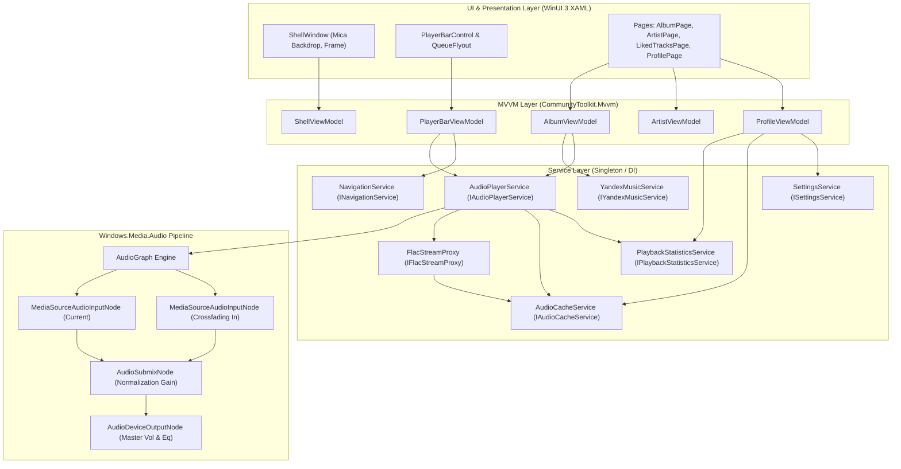
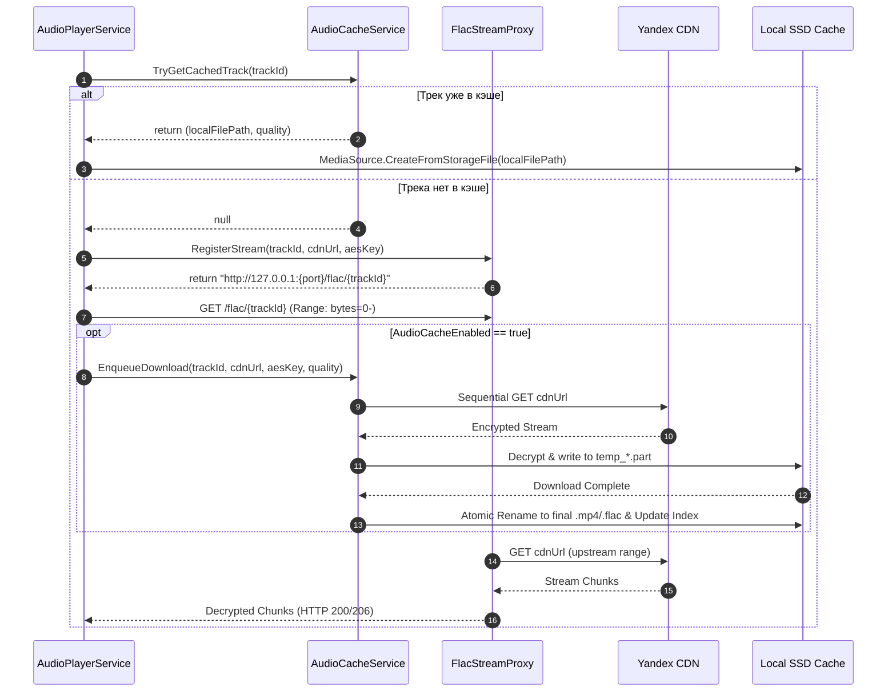
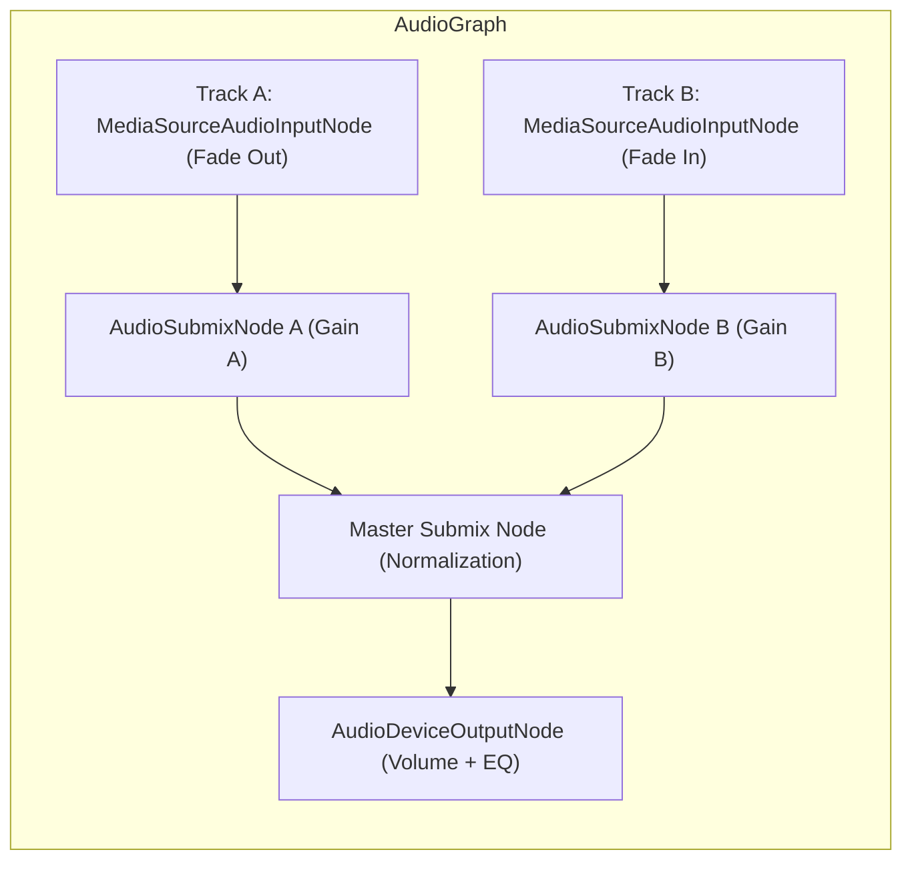

# Архитектурная спецификация и технический план WinYandex
**Платформа:** .NET 9.0 / Windows App SDK (WinUI 3) / C# 13  
**Проект:** `WinYandex` (`YMusic.WinUI`)  
**Дата:** Ноябрь 2026  
**Статус:** Готово к реализации  

---

## Введение и цели проекта

Приложение **WinYandex** представляет собой современный нативный десктопный клиент для сервиса Яндекс Музыка под Windows 10/11, построенный на базе современного стека технологий: **.NET 9**, **WinUI 3 (Windows App SDK)** и **CommunityToolkit.Mvvm**.

Цель настоящего документа — предоставить полную, промышленного качества архитектурную спецификацию для реализации 7 ключевых подсистем:
1. **Локальное дисковое кэширование FLAC (с соблюдением настроек пользователя)**
2. **Drag-and-Drop ручная сортировка очереди воспроизведения**
3. **Плавный переход между треками (Crossfade) на AudioGraph**
4. **Нормализация громкости (Loudness Normalization по EBU R128 / ReplayGain)**
5. **Сыгранные (предыдущие) треки в очереди + История воспроизведения**
6. **Статистика прослушивания в Настройках (в стиле Aria)**
7. **Улучшенная навигация к Артисту и Альбому с автоскроллом и подсветкой**

---

## 1. Архитектура подсистем и общая схема



---

## 2. Фича 1: Локальное дисковое кэширование FLAC

### 2.1. Анализ проблемы
В текущей реализации:
- `FlacStreamProxy` слушает локальный порт (`http://127.0.0.1:{port}/flac/{trackId}`), перенаправляет запросы к CDN Яндекса и расшифровывает AES-CTR на лету.
- `AudioCacheService` одновременно пытался скачать трек по второму GET-запросу, создавая двойную нагрузку на сеть, а расширение файла ошибочно задавалось `.mp3`, даже если контент был `flac-mp4`.
- При перемещении ползунка (Seek) `MediaPlayer` или `MediaSource` шлет HTTP Range-запросы (`Range: bytes=X-`), что приводило к срыву потокового скачивания.

### 2.2. Архитектура решения
1. **Двухуровневый контур кэширования:**
   - **Уровень 1 (Горячий кэш):** Если трек уже полностью скачан и валидирован на диске (`AudioCacheService.TryGetCachedTrack`), `AudioPlayerService` открывает локальный файл напрямую через `MediaSource.CreateFromStorageFileAsync` или `MediaSource.CreateFromUri(new Uri(localFilePath))` без обращения к сети и без участия локального HTTP-прокси.
   - **Уровень 2 (Онлайн-стриминг с Tee-Stream / фоновой финализацией):** Если трек отсутствует в кэше и в настройках включен кэш (`AudioCacheEnabled == true`), запускается дешифрующий поток через `FlacStreamProxy`.
2. **Обработка HTTP Range и предотвращение повреждения файлов:**
   - Если плеер посылает частичный запрос (`Range: bytes=start-end`), нельзя просто записывать фрагмент в конец файла.
   - Решение: `FlacStreamProxy` обслуживает запросы плеера с поддержкой HTTP 206 (Partial Content). Параллельно `AudioCacheService` запускает единый последовательный фоновый загрузчик (`TrackSequentialDownloader`), который с 0-го смещения за один HTTP-запрос скачивает весь трек, расшифровывает блоками по 64 КБ и пишет во временный файл `temp_{trackId}_{guid}.part`.
   - По завершении скачивания проверяется хеш/размер (Content-Length), файл атомарно перемещается в `{trackId}_flac_1411.mp4` (или `.flac`), и запись добавляется в `audio_cache_index.json`.
3. **Строгое соблюдение настроек пользователя:**
   - `AudioCacheEnabled`: При значении `false` загрузка на диск не инициируется, диск не читается, временные файлы не создаются.
   - `CacheSizeLimitMb`: Лимит размера кэша в мегабайтах (например, 1024, 2048, 5120 МБ; 0 — без лимита).
   - **LRU-эвикция (Least Recently Used):**
     При каждом воспроизведении из кэша обновляется поле `LastAccessedUtc`. Когда общий объем папки `Audio` превышает `CacheSizeLimitMb`, запускается эвикция с подушкой безопасности 15%: удаляются наиболее давно не воспроизводившиеся файлы до достижения 85% от лимита, чтобы предотвратить частые операции ввода-вывода при каждом новом треке.
   - **Кнопка очистки кэша в Настройках:**
     Асинхронный метод `ClearCacheAsync()` отменяет все активные загрузки, дожидается закрытия файловых дескрипторов, очищает директорию кэша и перезаписывает пустой индекс.



### 2.3. Структура интерфейсов и классов

```csharp
namespace YMusic.WinUI.Services.Interfaces;

public interface IAudioCacheService : IDisposable
{
    bool TryGetCachedTrack(string trackId, out string? filePath, out StreamAudioQuality? quality, bool updateAccessTime = true);
    bool IsTrackCached(string trackId);
    void EnqueueDownload(string trackId, string streamUrl, StreamAudioQuality? quality, byte[]? decryptionKey = null);
    Task<string?> CacheTrackAsync(string trackId, string streamUrl, StreamAudioQuality? quality, byte[]? decryptionKey = null, CancellationToken ct = default);
    Task ClearCacheAsync();
    long GetTotalCacheSizeBytes();
    int GetCachedTrackCount();
    void EnforceCacheLimit();
    Task<bool> ChangeCacheLocationAsync(string? newLocation, bool moveExistingFiles = true);
    event EventHandler? CacheUpdated;
}
```

```csharp
public sealed class AudioCacheEntry
{
    [JsonPropertyName("trackId")] public string TrackId { get; set; } = string.Empty;
    [JsonPropertyName("relativePath")] public string RelativePath { get; set; } = string.Empty;
    [JsonPropertyName("fileSizeBytes")] public long FileSizeBytes { get; set; }
    [JsonPropertyName("codec")] public string Codec { get; set; } = string.Empty;
    [JsonPropertyName("bitrateInKbps")] public int BitrateInKbps { get; set; }
    [JsonPropertyName("cachedAtUtc")] public DateTime CachedAtUtc { get; set; }
    [JsonPropertyName("lastAccessedUtc")] public DateTime LastAccessedUtc { get; set; }
}
```

---

## 3. Фича 2: Drag-and-Drop ручная сортировка очереди воспроизведения

### 3.1. Анализ проблемы
В WinYandex воспроизведение управляется двумя коллекциями в `AudioPlayerService`:
- `_queue` — исходный список треков (`List<Track>`).
- `_playOrder` — список индексов в `_queue`, задающий текущий порядок проигрывания.
- `_orderIndex` — индекс текущего играющего трека внутри `_playOrder`.

При ручной сортировке в UI перетаскиваются только элементы **UpNext** (будущие треки). Если наивно очистить и пересоздать `_queue`, текущий трек сбивается, теряются сыгранные треки, а режим перемешивания (Shuffle) ломается.

### 3.2. Архитектура решения
1. **XAML-конфигурация `ListView` в `QueueFlyout` (`PlayerBarControl.xaml`):**
   ```xml
   <ListView x:Name="UpNextQueueListView"
             ItemsSource="{x:Bind ViewModel.UpNextTracks, Mode=OneWay}"
             CanReorderItems="True"
             CanDragItems="True"
             AllowDrop="True"
             SelectionMode="None"
             IsItemClickEnabled="True"
             ItemClick="QueueListView_ItemClick"
             DragItemsCompleted="UpNextQueueListView_DragItemsCompleted">
   ```
2. **Алгоритм синхронизации индексов в `AudioPlayerService`:**
   Пусть в UI пользователь переместил элемент с позиции `uiOldIndex` на позицию `uiNewIndex` в списке `UpNextTracks`:
   - Внутри `_playOrder` срез предстоящих треков начинается с индекса `_orderIndex + 1`.
   - Исходный индекс в `_playOrder`:  
     $$\text{internalFrom} = \text{\_orderIndex} + 1 + \text{uiOldIndex}$$
   - Целевой индекс в `_playOrder`:  
     $$\text{internalTo} = \text{\_orderIndex} + 1 + \text{uiNewIndex}$$
   - Проверка границ:  
     $$\_orderIndex + 1 \le \text{internalFrom} < \_playOrder.Count$$  
     $$\_orderIndex + 1 \le \text{internalTo} < \_playOrder.Count$$
   - Выполняется перестановка в `_playOrder`:
     ```csharp
     int movedIndex = _playOrder[internalFrom];
     _playOrder.RemoveAt(internalFrom);
     _playOrder.Insert(internalTo, movedIndex);
     ```
   - **Критически важно:** `_orderIndex` и текущий узел воспроизведения `_currentInputNode` остаются абсолютно нетронутыми!
   - Треки, стоящие до `_orderIndex` (история), остаются нетронутыми.
   - Предзагрузка следующего трека (`TriggerUpcomingTracksPreload`) немедленно переключается на новый первый элемент очереди.
   - Состояние сессии (`SaveCurrentState()`) сериализуется с дебаунсом 500 мс.

---

## 4. Фича 3: Плавный переход между треками (Crossfade)

### 4.1. Архитектура аудиографа `AudioGraph`
Для бесшовного кроссфейда без задержек и щелчков используется двухпоточная схема входных узлов в одном экземпляре `Windows.Media.Audio.AudioGraph`.



### 4.2. Алгоритм Equal-Power Crossfade
Простое линейное затухание ($Gain_{out} = 1 - t$, $Gain_{in} = t$) вызывает ощутимый провал громкости в середине перехода (-3 дБ по мощности).  
В WinYandex применяется профессиональная кривая равной мощности (Equal-Power):

$$Gain_{out}(t) = \cos\left(t \cdot \frac{\pi}{2}\right), \quad Gain_{in}(t) = \sin\left(t \cdot \frac{\pi}{2}\right), \quad t \in [0, 1]$$

Поскольку $\cos^2(x) + \sin^2(x) = 1$, суммарная акустическая мощность остается постоянной на протяжении всего перехода.

### 4.3. Временная диаграмма и обработка событий
1. **Точка запуска кроссфейда:**
   - Настраиваемая длительность $T_{cf} \in [1, 12]$ секунд (по умолчанию 4 с).
   - В таймере позиции (шаг 250 мс):
     $$\text{Position} \ge \text{Duration} - T_{cf}$$
   - Создается входной узел `_fadingInNode = await _audioGraph.CreateMediaSourceAudioInputNodeAsync(nextSource)`.
   - `_fadingInNode.OutgoingGain = 0.0`.
   - `_fadingInNode.Start()`.
2. **Дискретизация кривой:**
   - Частота обновления: 25 кадров в секунду (интервал 40 мс).
   - Шагов: $N = T_{cf} \times 25$.
   - В цикле с `CancellationToken`: вычисляется $t = step / N$, выставляются `OutgoingGain` для обоих узлов.
3. **Завершение перехода:**
   - По окончании цикла `_fadingOutNode.Stop()`, соединение с графом разрывается, вызывается `.Dispose()`.
   - `_currentInputNode = _fadingInNode`.
   - `_currentInputNode.OutgoingGain = 1.0`.
4. **Anti-Click Micro-Fade при ручном переключении (Next / Prev / Stop):**
   - Если пользователь нажимает Next/Prev вручную, резкая остановка `Stop()` приводит к щелчку из-за разрыва звуковой волны ненулевой амплитуды.
   - Решение: метод `MicroFadeOutAndStopAsync(node, durationMs: 40)` выполняет мгновенный линейный спад громкости за 40 мс перед остановкой узла, полностью устраняя артефакты щелчков.

---

## 5. Фича 4: Нормализация громкости (Loudness Normalization)

### 5.1. Стандарты и метаданные API
В официальном API Яндекс Музыки каждый объект трека содержит метаданные громкости по стандарту **EBU R128**:
```json
{
  "id": "12345678",
  "title": "Track Title",
  "r128": {
    "i": -10.8,
    "tp": -0.5
  },
  "normalization": {
    "gain": -3.2,
    "peak": 32767
  }
}
```
- `r128.i` — Integrated Loudness в LUFS (интегральная громкость трека).
- `r128.tp` — True Peak в dBTP (пиковый уровень волны).
- `normalization.gain` — готовое значение коррекции усиления в дБ от бэкенда Яндекса.

### 5.2. Модель данных в C#
```csharp
namespace YMusic.WinUI.Models;

public sealed class R128Metadata
{
    [JsonPropertyName("i")] public double IntegratedLoudnessLufs { get; set; } = -14.0;
    [JsonPropertyName("tp")] public double TruePeakDbTp { get; set; } = 0.0;
}

public sealed class NormalizationMetadata
{
    [JsonPropertyName("gain")] public double GainDb { get; set; } = 0.0;
    [JsonPropertyName("peak")] public int Peak { get; set; } = 32767;
}
```

### 5.3. Формула вычисления коэффициента усиления
Целевой уровень громкости для стриминга:  
$$TargetLUFS = -14.0\ \text{LUFS}$$

1. Если доступен `Track.R128`:
   $$\Delta dB = TargetLUFS - R128.IntegratedLoudnessLufs$$
2. Иначе, если доступен `Track.Normalization`:
   $$\Delta dB = Normalization.GainDb$$
3. Иначе:
   $$\Delta dB = 0.0\ \text{dB}$$

**Защита от клиппинга (Peak Limiter Ceiling):**  
Если $\Delta dB > 0$ (тихая классическая музыка усиливается), усиление не должно превышать потолок, при котором True Peak выйдет за пределы $-1.0\ \text{dBTP}$:
$$\Delta dB_{safe} = \min(\Delta dB, -1.0 - R128.TruePeakDbTp)$$

Линейный множитель усиления для узла аудиографа:
$$GainMultiplier = 10^{\frac{\Delta dB_{safe}}{20}}$$

В `AudioPlayerService` вычисленный `GainMultiplier` применяется к входному узлу или промежуточному `AudioSubmixNode`:
```csharp
double targetGain = _settingsService.LoudnessNormalizationEnabled ? track.CalculateNormalizationGain() : 1.0;
_currentInputNode.OutgoingGain = targetGain * crossfadeGain;
```

---

## 6. Фича 5: Сыгранные (предыдущие) треки в очереди + История сессии

### 6.1. Архитектура представления очереди в `QueueFlyout`
В текущей версии в выпадающей панели очереди отображается только блок «Сейчас играет» и список «Далее в очереди». Пользователь не может посмотреть, что играло до этого, и вернуться к предыдущему треку.

Новая структура `QueueFlyout`:
```
+-------------------------------------------------------------+
| Очередь воспроизведения (Всего: 18)             [Очистить]   |
+-------------------------------------------------------------+
| v РАНЕЕ ИГРАЛИ (3)                                          |
|   1. Artist - Past Track 1                            [>]   |
|   2. Artist - Past Track 2                            [>]   |
|   3. Artist - Past Track 3                            [>]   |
+-------------------------------------------------------------+
| * СЕЙЧАС ИГРАЕТ                                             |
|   [Cover] Track Title - Artist Name           [Equalizer]   |
+-------------------------------------------------------------+
| v ДАЛЕЕ В ОЧЕРЕДИ (14)                     [Перетаскивание] |
|   = 1. Artist - Upcoming Track 1               [X] [::: Drag]
|   = 2. Artist - Upcoming Track 2               [X] [::: Drag]
|   = 3. Artist - Upcoming Track 3               [X] [::: Drag]
+-------------------------------------------------------------+
```

### 6.2. Модель данных в `PlayerBarViewModel`
```csharp
public sealed partial class PlayerBarViewModel : BaseViewModel
{
    // Коллекция сыгранных треков текущей сессии
    public ObservableCollection<Track> PlayedTracks { get; } = new();

    // Коллекция предстоящих треков (с поддержкой Reorder)
    public ObservableCollection<Track> UpNextTracks { get; } = new();

    [ObservableProperty] private int _playedTracksCount;
    [ObservableProperty] private int _upNextTracksCount;
    [ObservableProperty] private bool _hasPlayedTracks;
    [ObservableProperty] private bool _hasUpNextTracks;

    [RelayCommand]
    private async Task PlayHistoryTrackAsync(Track? track)
    {
        if (track == null) return;
        await _audioPlayer.PlayTrackFromHistoryAsync(track);
    }
}
```

### 6.3. Интеграция с `IAudioPlayerService`
- Свойство `IReadOnlyList<Track> PlayedQueue => _orderIndex > 0 ? _playOrder.Take(_orderIndex).Select(i => _queue[i]).ToList() : Array.Empty<Track>();`
- При клике на трек из истории `PlayTrackFromHistoryAsync(track)`:
  Ищется индекс трека в `_playOrder[0 .. _orderIndex - 1]`. Найденный индекс становится новым `_orderIndex`, вызывается `LoadAndPlayTrackAsync`, очередь не сбрасывается! Пользователь может в любой момент нажать «Далее» и вернуться к предстоящим трекам.

---

## 7. Фича 6: Статистика прослушивания в Настройках (в стиле Aria)

### 7.1. Бизнес-правила учета прослушиваний
Трек считается официально прослушанным («засчитанным» в статистику), если выполнено хотя бы одно из условий:
1. Непрерывное время прослушивания $\ge 30$ секунд.
2. Прослушано $\ge 50\%$ от полной длительности трека.

Каждое воспроизведение уникально маркируется идентификатором сессии `(trackId, playSessionId)`, чтобы паузы, перемотки назад и повторные старты в рамках одного прослушивания не накручивали счетчик.

### 7.2. Сервис статистики `IPlaybackStatisticsService`
```csharp
namespace YMusic.WinUI.Services.Interfaces;

public interface IPlaybackStatisticsService
{
    Task RecordTrackProgressAsync(string trackId, TimeSpan position, TimeSpan duration, bool isPlaying);
    Task TrackPlaybackFinishedAsync(string trackId);
    
    ListeningStatsSummary GetSummary();
    IReadOnlyList<DailyListeningData> GetLastDays(int daysCount);
    Task ClearStatisticsAsync();

    event EventHandler? StatisticsUpdated;
}
```

### 7.3. Схема хранения данных (JSON в `LocalApplicationData`)
Путь: `%LocalAppData%\YMusic\Data\playback_statistics.json`.

```json
{
  "version": 1,
  "totalTracksPlayed": 1420,
  "totalListeningSeconds": 312540,
  "dailyStats": {
    "2026-11-15": {
      "date": "2026-11-15",
      "tracksCount": 42,
      "listeningSeconds": 8540,
      "topArtists": {
        "Radiohead": 12,
        "Daft Punk": 8
      }
    },
    "2026-11-14": {
      "date": "2026-11-14",
      "tracksCount": 35,
      "listeningSeconds": 7200
    }
  }
}
```
**Надежность:** Асинхронная запись с двойной буферизацией (write to `*.tmp` + atomic `File.Move`), защита от сбоев питания, дебаунс сохранения 5 секунд.

### 7.4. UI-компонент карточки статистики в `ProfilePage.xaml`
В секцию Настроек (`ProfilePage.xaml`) добавляется блок в премиальном стиле Aria / Fluent:
- **KPI-карточки:**
  - «Сегодня»: 42 трека • 2 ч 22 мин
  - «За последние 7 дней»: 215 треков • 14.5 часов
  - «За всё время»: 1,420 треков • 86.8 часов
- **Интерактивная гистограмма активности:**
  XAML `ItemsControl` со столбцами за последние 7 или 14 дней. Столбцы имеют скругленные углы (`CornerRadius="4"`), высоту, пропорциональную максимуму за период, акцентную заливку и всплывающие подсказки `ToolTipService.ToolTip` с детальной информацией («15 ноя: 42 трека, 2 ч 22 мин»).

```xml
<Border Background="{ThemeResource CardBackgroundFillColorDefaultBrush}"
        BorderBrush="{ThemeResource CardStrokeColorDefaultBrush}"
        BorderThickness="1"
        CornerRadius="12"
        Padding="20">
    <StackPanel Spacing="16">
        <StackPanel Orientation="Horizontal" Spacing="10" VerticalAlignment="Center">
            <FontIcon Glyph="&#xE9D2;" FontSize="18" Foreground="{ThemeResource AccentFillColorDefaultBrush}" />
            <TextBlock Text="{x:Bind ViewModel.ListeningStatsTitle, Mode=OneWay}" FontSize="16" FontWeight="SemiBold" />
        </StackPanel>
        
        <!-- Сводные метрики -->
        <Grid ColumnSpacing="12">
            <Grid.ColumnDefinitions>
                <ColumnDefinition Width="*" />
                <ColumnDefinition Width="*" />
                <ColumnDefinition Width="*" />
            </Grid.ColumnDefinitions>
            <!-- Карточка Сегодня -->
            <Border Grid.Column="0" Background="{ThemeResource CardBackgroundFillColorSecondaryBrush}" CornerRadius="8" Padding="14">
                <StackPanel Spacing="4">
                    <TextBlock Text="{x:Bind ViewModel.StatsTodayLabel, Mode=OneWay}" FontSize="11" Foreground="{ThemeResource TextFillColorSecondaryBrush}" />
                    <TextBlock Text="{x:Bind ViewModel.StatsTodayValue, Mode=OneWay}" FontSize="18" FontWeight="Bold" />
                    <TextBlock Text="{x:Bind ViewModel.StatsTodayDuration, Mode=OneWay}" FontSize="12" Foreground="{ThemeResource AccentFillColorDefaultBrush}" />
                </StackPanel>
            </Border>
            <!-- Карточка 7 дней -->
            <Border Grid.Column="1" Background="{ThemeResource CardBackgroundFillColorSecondaryBrush}" CornerRadius="8" Padding="14">
                <StackPanel Spacing="4">
                    <TextBlock Text="{x:Bind ViewModel.StatsWeekLabel, Mode=OneWay}" FontSize="11" Foreground="{ThemeResource TextFillColorSecondaryBrush}" />
                    <TextBlock Text="{x:Bind ViewModel.StatsWeekValue, Mode=OneWay}" FontSize="18" FontWeight="Bold" />
                    <TextBlock Text="{x:Bind ViewModel.StatsWeekDuration, Mode=OneWay}" FontSize="12" Foreground="{ThemeResource AccentFillColorDefaultBrush}" />
                </StackPanel>
            </Border>
            <!-- Карточка Всего -->
            <Border Grid.Column="2" Background="{ThemeResource CardBackgroundFillColorSecondaryBrush}" CornerRadius="8" Padding="14">
                <StackPanel Spacing="4">
                    <TextBlock Text="{x:Bind ViewModel.StatsTotalLabel, Mode=OneWay}" FontSize="11" Foreground="{ThemeResource TextFillColorSecondaryBrush}" />
                    <TextBlock Text="{x:Bind ViewModel.StatsTotalValue, Mode=OneWay}" FontSize="18" FontWeight="Bold" />
                    <TextBlock Text="{x:Bind ViewModel.StatsTotalDuration, Mode=OneWay}" FontSize="12" Foreground="{ThemeResource AccentFillColorDefaultBrush}" />
                </StackPanel>
            </Border>
        </Grid>

        <!-- Столбчатый график активности по дням недели -->
        <ItemsControl ItemsSource="{x:Bind ViewModel.DailyActivityBars, Mode=OneWay}">
            <ItemsControl.ItemsPanel>
                <ItemsPanelTemplate>
                    <StackPanel Orientation="Horizontal" HorizontalAlignment="SpaceBetween" VerticalAlignment="Bottom" Height="100" />
                </ItemsPanelTemplate>
            </ItemsControl.ItemsPanel>
            <ItemsControl.ItemTemplate>
                <DataTemplate x:DataType="vm:DailyBarViewModel">
                    <StackPanel Spacing="6" HorizontalAlignment="Center" Width="36" ToolTipService.ToolTip="{x:Bind TooltipText}">
                        <Border Height="{x:Bind BarHeight}" Width="16" Background="{ThemeResource AccentFillColorDefaultBrush}" CornerRadius="4,4,0,0" VerticalAlignment="Bottom" />
                        <TextBlock Text="{x:Bind DayLabel}" FontSize="11" HorizontalAlignment="Center" Foreground="{ThemeResource TextFillColorSecondaryBrush}" />
                    </StackPanel>
                </DataTemplate>
            </ItemsControl.ItemTemplate>
        </ItemsControl>
    </StackPanel>
</Border>
```

---

## 8. Фича 7: Улучшенная навигация к Артисту и Альбому

### 8.1. Выделенная страница `AlbumPage.xaml` и `AlbumViewModel`
В текущей реализации открытие альбома перенаправляло на `PlaylistsPage` с выставлением `SelectedCategoryIndex = 1`. Это приводило к сбиванию истории переходов в `Frame`, отсутствию независимого скролла и невозможности таргетированной подсветки трека.

Архитектура отдельной `AlbumPage`:
- **Навигация:** `ContentFrame.Navigate(typeof(AlbumPage), new AlbumNavigationArgs(albumId, targetTrackId))`
- **Поддержка BackStack:** Кнопка «Назад» возвращает пользователя в точности на ту страницу, откуда он пришел (`LikedTracksPage`, `SearchPage`, `ArtistPage` и т.д.).
- **Модель навигационных аргументов:**
  ```csharp
  public sealed record AlbumNavigationArgs(long AlbumId, string? TargetTrackId = null, string? AlbumTitle = null);
  ```

### 8.2. Автоматическая прокрутка и акцентная подсветка трека (Highlight)
Когда пользователь нажимает в контекстном меню «Перейти к альбому»:
1. `AlbumViewModel` загружает треки альбома через `IYandexMusicService.GetAlbumWithTracksAsync(albumId)`.
2. После наполнения `ObservableCollection<Track>` в коде страницы `AlbumPage.xaml.cs`:
   ```csharp
   if (!string.IsNullOrEmpty(_targetTrackId))
   {
       var targetTrack = ViewModel.Tracks.FirstOrDefault(t => Track.IsSameTrackId(t.Id, _targetTrackId));
       if (targetTrack != null)
       {
           TracksListView.ScrollIntoView(targetTrack, ScrollIntoViewAlignment.Leading);
           targetTrack.IsHighlighted = true;
           
           // Плавный сброс подсветки через 2.5 секунды
           _ = Task.Delay(2500).ContinueWith(_ => DispatcherQueue.TryEnqueue(() => targetTrack.IsHighlighted = false));
       }
   }
   ```
3. В XAML-шаблоне элемента трека фон привязан к `IsHighlighted`:
   ```xml
   <Border Background="{x:Bind IsHighlighted, Mode=OneWay, Converter={StaticResource BoolToHighlightBrushConverter}}"
           CornerRadius="8"
           Padding="10,6">
   ```

### 8.3. Клик по артисту в строке любого трека и в плеере
1. **Строки треков (`DataTemplate`):**
   Все вхождения имени артиста оформляются как `HyperlinkButton` (или кликабельный `TextBlock` со стилем гиперссылки).
   Клик обрабатывается через единый `ArtistNavigationHelper.NavigateToTrackArtistAsync(sender as FrameworkElement, track)`:
   - Если у трека 1 артист: мгновенный переход на `ArtistPage` с передачей ID артиста.
   - Если у трека 2 и более артистов: открывается компактный `MenuFlyout` со списком артистов для точного выбора пользователем.
2. **Контекстное меню трека (`TrackMenuHelper.cs`):**
   Добавляются пункты:
   - **«Перейти к исполнителю»** (Glyph `\uE77B`)
   - **«Перейти к альбому»** (Glyph `\uE93C`)

---

## 9. Пошаговый план внедрения и контрольные точки

| Этап | Задача | Затрагиваемые файлы | Критерий приемки |
| :--- | :--- | :--- | :--- |
| **Этап 1** | Модели данных и настройки | `AppSettings.cs`, `ISettingsService.cs`, `SettingsService.cs`, `Track.cs` | Добавлены поля R128, Normalization, CrossfadeDuration, CacheSizeLimit, Stats |
| **Этап 2** | Кэширование FLAC и Range | `FlacStreamProxy.cs`, `AudioCacheService.cs`, `AudioPlayerService.cs` | Отдача из дискового кэша без сети, LRU-очистка, скачивание без дублирования трафика |
| **Этап 3** | AudioGraph: Crossfade & Normalization | `AudioPlayerService.cs`, `EqualizerService.cs` | Equal-Power кроссфейд 1-12с, anti-click micro-fade, выравнивание громкости по -14 LUFS |
| **Этап 4** | Drag-and-Drop & Очередь | `PlayerBarControl.xaml`, `PlayerBarViewModel.cs`, `AudioPlayerService.cs` | Плавное перетаскивание в `ListView`, сохранение текущего играющего трека, секция «Ранее играли» |
| **Этап 5** | Статистика прослушивания | `PlaybackStatisticsService.cs`, `ProfileViewModel.cs`, `ProfilePage.xaml` | Учет треков (>30 сек или >50%), гистограмма за 7 дней, хранение в `playback_statistics.json` |
| **Этап 6** | AlbumPage & Навигация | `AlbumPage.xaml`, `AlbumViewModel.cs`, `TrackMenuHelper.cs`, `NavigationService.cs` | Переход в альбом с автоскроллом и подсветкой, переход к артисту из меню и строк треков |
| **Этап 7** | Тестирование и стабилизация | Весь проект | Компиляция `dotnet build`, отсутствие утечек дескрипторов, потокобезопасность на `DispatcherQueue` |

---

## 10. Потокобезопасность и обработка исключений
1. **Работа с UI-потоком:** Все обновления `ObservableCollection` и свойств с `[ObservableProperty]` строго оборачиваются в `DispatcherQueue.TryEnqueue` или методы `RunOnUi`.
2. **Аудио-поток (AudioGraph):** Все манипуляции с узлами (`AddOutgoingConnection`, `Stop`, `Dispose`) выполняются синхронизированно с блокировкой отмены (`CancellationTokenSource`), исключая `ObjectDisposedException` при резких действиях пользователя.
3. **Файловый ввод-вывод:** Чтение и запись индексов кэша и статистики производятся через промежуточный атомарный файл (`.tmp` -> `.json`), предотвращая повреждение данных при аварийном завершении приложения.
